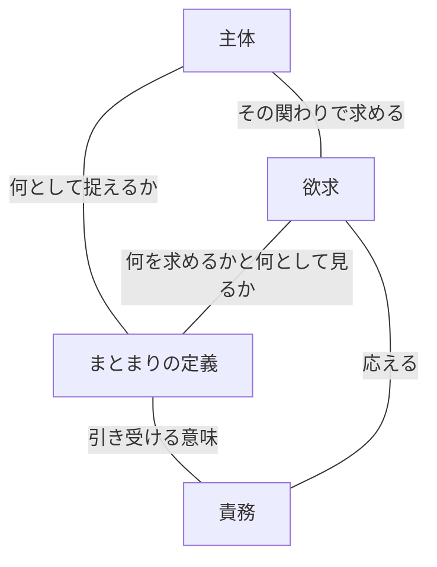

# 収録した対話

当時のターン順索引に従い、話者別に保存された発言本文を配列した。

## U1 — ユーザー

<!-- source: USER_MESSAGES.md:L10-L14 -->
一旦ここから基礎となるような哲学を見出していきたい。
もととなる文章自体はかなりあるはずだ。
AONと原本や記録に関しては後回しでいい。ほかの哲学と合わせて議論したいし。

定義・命名・契約　や　境界面理論　や　欲求・責務や　主体　といったそこら辺の哲学だけ適切に体系化してみてほしい
<!-- end-source -->

## A1 — AI

<!-- source: ASSISTANT_MESSAGE_A1.md:L10-L395 -->
マスター、この範囲は、**「意味ある存在と相互作用を、どの主体が、どの定義のもとで引き受けるか」**を中心に据えると、一つの哲学として組み立てられます。

構成は、次の六章が適切だと思います。**定義を基礎に置き、主体・欲求・責務との関係を明らかにしたうえで、契約と内部自由、相互作用、境界の選定、定義の更新へ展開する**形です。

推敲できる文書にもまとめました。  
[定義と主体を基礎とする開発哲学の体系案](https://chatgpt.com/space/page_d508aa31baa08191be7d61a59e6e6700)

以下に、体系案の内容と、この構成にする理由を書きます。章立てや概念の書き分けは、今回私が提案する整理です。

# 体系の全体構成

| 章 | 中心となる問い | 体系内での役割 |
|---|---|---|
| **1．まとまりと定義** | 何を、一つの存在として扱うのか | 意味ある存在の成立を説明する |
| **2．主体・欲求・責務** | どの立場から何を求め、何を引き受けるのか | 定義を方向づける関係を説明する |
| **3．契約と内部自由** | 引き受ける意味と、内側の自由はどう関係するか | 定義された存在の特性を説明する |
| **4．相互作用と実態** | 定義をどう共有し、現にある状態と関係づけるか | 相互確証と運用を説明する |
| **5．境界面理論** | どの高さまで主体と責務を分け、どこで止めるか | 再帰的な境界選定を扱う |
| **6．再定義と脱皮** | 欲求や実態の変化にどう応えるか | 定義と構造の更新を扱う |

この順序は、理解のための説明順序です。定義・命名・契約・境界が、この順に一つずつ生成されるという意味ではありません。

---

# 1．まとまりと定義

## 1.1 まとまりは、主体に相対的な定義として成立する

最も基礎に置く命題は、次のものです。

> **私たちが何かを一つの意味ある存在として扱うとき、そのまとまりは、主体がどの意味で捉えるかという定義のもとで成立する。**

現にある対象について、どこを区切り、何を一つと数え、何として扱うかは、一意に定まりません。

同じ時計を、金属原子の集合、歯車やばねの集合、時間を知るための時計、時計塔の一部として捉えられる。また、同じ棒を、体を支えるもの、目印、日時計として捉えられる。

ここには、二つの変化があります。

- **縦方向の違い**：原子、部品、時計、時計塔という、まとまりの高さの違い。
- **横方向の違い**：同じ棒を支え、目印、日時計と捉える、意味の違い。

このような「何を一つの存在とするか」が仮想的なのですね。物理的な状態や作用は存在していても、そこにどの意味のまとまりを見るかは、主体の定義において成立する。

したがって、哲学の出発点は、**扱う単位そのものを意味として成立させること**にあります。  
出典：[命名の対話 U2–U6](https://github.com/Daiki-Yoshida/documents-artifacts/blob/68b22a7481fe762fdd6d8c920cfa0ba96dddc3a0/documents/knowledge/records/2026-11-11-naming-semantics-contract-philosophy-philosophy-baseline/USER_MESSAGES.md)、[仮想的なまとまりの対話 U2–U3](https://github.com/Daiki-Yoshida/documents-artifacts/blob/68b22a7481fe762fdd6d8c920cfa0ba96dddc3a0/documents/knowledge/records/2026-11-12-virtual-boundary-and-responsibility-philosophy-baseline/USER_MESSAGES.md)

## 1.2 定義・命名・本質・抽象・契約・境界は、一体のものとして捉える

「これは時計である」と定義するとき、その行為を複数の側面から説明できます。

| 側面 | 同じ定義行為の、何を捉えているか |
|---|---|
| **定義** | 何を、どの意味のまとまりとして扱うかを定める |
| **命名** | その存在が何であるかを、名前として宣言する |
| **本質** | その定義において、その存在が何であるとされるか |
| **抽象** | 特定の具象を固定せず、定義された意味を持つ存在として扱えること |
| **契約** | 相互作用において、その意味を前提として扱う約束 |
| **境界** | その存在として引き受ける意味と、内外の関係が区切られること |

ここで表に分けたのは、説明上の視点です。

**定義＝命名＝本質＝抽象＝契約＝境界**

という一体性を中心に置きます。

たとえば「時計」という命名は、その物を時計として扱うことを宣言している。その意味を前提に関わることが契約であり、時計として引き受ける範囲が境界になる。

同時に、抽象としての時計は、内部が針やばねであることまで要求しません。時間を知るという意味を、デジタル表示でも、日時計でも実現できる。

このため、**意味を確かに定義することと、具象を固定しないことは両立する**。この関係が、後の内部自由につながります。

そして、名前の重要性もここに位置付けられる。「何として扱うか」を宣言している以上、実態に機能が増えたからといって、そのすべてを同じ名前の意味へ自動的に流し込むことはできません。引き受ける意味が変わるときには、定義を更新する必要があるわけです。  
出典：[命名の対話 U3–U8](https://github.com/Daiki-Yoshida/documents-artifacts/blob/68b22a7481fe762fdd6d8c920cfa0ba96dddc3a0/documents/knowledge/records/2026-11-11-naming-semantics-contract-philosophy-philosophy-baseline/USER_MESSAGES.md)、[境界面の対話 U6–U7](https://github.com/Daiki-Yoshida/documents-artifacts/blob/68b22a7481fe762fdd6d8c920cfa0ba96dddc3a0/documents/knowledge/records/2026-11-11-boundary-horizon-dialogue-philosophy-baseline/USER_MESSAGES.md)

# 2．主体・欲求・責務

第1章で「主体の定義」と言った以上、次に明らかにするべきなのは、その主体が何であり、何によって定義を方向づけるかです。

## 2.1 主体は、ある関わりに立つ立場である

この体系では、主体を次のように置きます。

> **主体とは、ある関わりにおいて、何かを捉え、定義し、判断し、相互作用する立場である。**

同じ個体でも、PCを組み立てるときと、PCを利用するときでは、異なる主体として関わる。

組み立てる主体には、CPU、GPU、メモリなどの契約が現れる。利用する主体には、PC全体の契約が現れる。

したがって、主体を特定するときには、**「誰という個体か」に加えて、「何として関わっているか」**を問う必要があります。

同じ個体の中に、異なる主体と、それぞれの欲求・契約が共存できる。この性質が、後のフラクタルな責務構造を支えます。  
出典：[境界面の対話 U2–U3](https://github.com/Daiki-Yoshida/documents-artifacts/blob/68b22a7481fe762fdd6d8c920cfa0ba96dddc3a0/documents/knowledge/records/2026-11-11-boundary-horizon-dialogue-philosophy-baseline/USER_MESSAGES.md)、[主体と責務の対話 U4–U5](https://github.com/Daiki-Yoshida/documents-artifacts/blob/68b22a7481fe762fdd6d8c920cfa0ba96dddc3a0/documents/knowledge/records/2026-11-12-virtual-boundary-and-responsibility-philosophy-baseline/USER_MESSAGES.md)

## 2.2 欲求と責務は、同じ関係の両側にある

ここは、次のように定式化するとつながります。

> **欲求は、主体が相手に何を求めるかという方向である。責務は、定義されたまとまりが、その欲求に応えるために引き受ける意味である。**

時計に向けられる「時刻を知りたい」という欲求と、時計の「時刻を知ることを成立させる」という責務は、同じ関係を異なる側から捉えている。

そして、マスターが強調したとおり、**何を求めるかを定めることと、それを何として見るかを定めることは、同じ問い**です。

棒に時刻を知ることを求める関わりでは、それを日時計として捉えている。目印を求める関わりでは、同じ棒に別の意味を見ている。

したがって、「欲求を決め、その後にまとまりを選ぶ」という一方向の手順にはしません。欲求の方向と、まとまりの定義とが結び付いている、と位置付けます。

なお、責務に対応するのは、**その関係で定義された欲求の範囲**です。ある主体の無数の欲求のうち、どの欲求を相手へ向け、その相手がどの意味を引き受けるかが定義されます。  
出典：[境界選定の対話 U1–U3・U8–U10](https://github.com/Daiki-Yoshida/documents-artifacts/blob/68b22a7481fe762fdd6d8c920cfa0ba96dddc3a0/documents/knowledge/records/2026-11-11-boundary-selection-and-split-pressure-philosophy-baseline/USER_MESSAGES.md)

## 2.3 主体・欲求・対象は、互いの意味を規定する

ここまでを体系として組むなら、主体自身も、関わりの意味によって捉えられたまとまりとして置くのが自然です。

「PC利用者」という主体は、PCを利用するという関わりの中で成立する。同時に、その主体が何を求めるかによって、PCとして扱う範囲や契約の意味も変わる。

この関係は、次のように描けます。線は概念の対応関係を表します。

**主体・欲求・対象のどれか一つを、絶対的な出発点として固定する必要はない**。説明するときには一つを仮に定めて他を述べられますが、体系としては互いを規定する関係に置く。

この「相互に規定される関係」という説明が、今回の整理で私が加えた接続です。同一個体が複数主体となることと、欲求の方向とまとまりの定義が同じ問いであることを、一つにつなげています。

# 3．契約と内部自由

## 3.1 契約によって、引き受ける意味を確かに扱う

契約によって、その存在を何として扱い、何を前提に相互作用するかが定まります。

この体系で「境界を堅牢にする」は、**引き受けた意味を、相互作用の前提として確かに扱えるようにすること**に位置付けられます。

GPUをGPUとして扱えるなら、利用側は内部の配線や製造工程まで直接扱う必要がない。一方、製造側には、部品や回路について別の契約がある。

それぞれの主体にとって、必要な意味が確かであるからこそ、その境界を介して関われる。ここに「中を見なくてよい」という性質があります。  
出典：[境界面の対話 U2・U6](https://github.com/Daiki-Yoshida/documents-artifacts/blob/68b22a7481fe762fdd6d8c920cfa0ba96dddc3a0/documents/knowledge/records/2026-11-11-boundary-horizon-dialogue-philosophy-baseline/USER_MESSAGES.md)、[境界選定の対話 U6–U8](https://github.com/Daiki-Yoshida/documents-artifacts/blob/68b22a7481fe762fdd6d8c920cfa0ba96dddc3a0/documents/knowledge/records/2026-11-11-boundary-selection-and-split-pressure-philosophy-baseline/USER_MESSAGES.md)

## 3.2 内部自由は、定義に相対的な特性である

ここから、内部自由を次のように位置付けます。

> **定義された存在が、その意味を保つ範囲で内部の実現を選べることが、その定義に相対的な内部自由である。**

たとえば、次のように変わります。

| 採る定義 | その定義に対して自由なこと |
|---|---|
| 時計塔 | 時計が機械式か、デジタル式か、映像表示か |
| 歯車や機械部品からなる機構 | 契約で指定されていない材質や内部形状 |

時計塔という定義では許される選択でも、機械部品の機構という定義では意味が変わる場合がある。**自由の範囲は、何を定義したかに依存する**わけですね。

そのため、内部自由を定義から切り離して、量だけを最大化する目標には置きません。引き受けた意味との関係に現れる性質として扱います。

また、内部でさらに契約を作ることも、その自由の一つです。GPUの内部をコア、メモリ、冷却機構に分ければ、それぞれに自由な内部を成立させられる。

ここから、独立した変更や交換が可能になることがあります。変更容易性は、この構造から生じ得る効果として説明できます。  
出典：[仮想的なまとまりの対話 U2](https://github.com/Daiki-Yoshida/documents-artifacts/blob/68b22a7481fe762fdd6d8c920cfa0ba96dddc3a0/documents/knowledge/records/2026-11-12-virtual-boundary-and-responsibility-philosophy-baseline/USER_MESSAGES.md)、[境界選定の対話 U20–U21](https://github.com/Daiki-Yoshida/documents-artifacts/blob/68b22a7481fe762fdd6d8c920cfa0ba96dddc3a0/documents/knowledge/records/2026-11-11-boundary-selection-and-split-pressure-philosophy-baseline/USER_MESSAGES.md)

# 4．相互作用と実態

ここで、意味の定義を、現にある状態や複数主体の関係へ接続します。

## 4.1 相互作用そのものにも、意味が定義される

同じ音が、ある主体には騒音、別の主体には警報となる。

ここには、空気の振動という作用と、それを何の知らせとして利用し、どう応答するかという関係の意味があります。

存在のまとまりを定義するとともに、**その間の伝達や働きかけを、何として利用するかも定義される**。

原文で訂正された、

> 定義なしには、新しい相互作用を成り立たせることは出来ない。

という命題は、ここに置けます。

新しい関係を成立させるときには、何と何が関わるかだけでなく、その関わりをどういう意味のものとして扱うかが必要になる、という位置付けです。  
出典：[定義と相互作用の対話 U2–U4](https://github.com/Daiki-Yoshida/documents-artifacts/blob/68b22a7481fe762fdd6d8c920cfa0ba96dddc3a0/documents/knowledge/records/2026-11-13-definition-interaction-shared-reality-and-metamorphosis-philosophy-baseline/USER_MESSAGES.md)

## 4.2 定義・運用・実態を区別する

| 観点 | 扱うもの |
|---|---|
| **定義** | 何を何として扱うかという、仮想的な意味と契約 |
| **運用** | その定義のもとで、対象を使用し、構築し、扱い、変更する営み |
| **実態** | 現にある状態・構造・働き・振る舞い |

仮想的な定義と実態の間には、直接の従属関係はありません。定義が運用の方向を与え、その運用が実態へ働きかける。

実態が変わっても、定義された意味が自動的に変わるわけではない。逆に、同じ実態を改造せずに、別のまとまりとして捉え直すこともできる。

このため、定義と実態には乖離が起こり得ます。

そこでの判断は、次の形になります。

> **乖離を認識したときは、どの主体の、どの契約に対する乖離なのかを特定し、実態の変更や定義の更新を判断する。**

ここでは、実態だけを見て「正しい／間違い」とすることも、定義だけを見て対応が済んだとすることもできない。**特定の主体・契約と実態との関係**として扱う必要があります。  
出典：[仮想と実態の対話 U3・U7–U8](https://github.com/Daiki-Yoshida/documents-artifacts/blob/68b22a7481fe762fdd6d8c920cfa0ba96dddc3a0/documents/knowledge/records/2026-11-12-virtual-boundary-and-responsibility-philosophy-baseline/USER_MESSAGES.md)

## 4.3 契約の「成立」は、三つの観点で読む

これは、今回私が提案する整理です。

原文にある「仮想側では命名時点で成立している」「相互に確証されて成立する」「実態が乖離する」を、次の三つの問いとして並べます。

| 観点 | 問うこと |
|---|---|
| **仮想的な定義の成立** | その主体において、何がどの意味で定義されているか |
| **主体間の相互確証** | 関係する主体の間で、どの意味を前提として扱う契約が確証されているか |
| **実態との整合** | 現にある状態や振る舞いが、どの主体のどの契約に適合しているか |

同じ契約を、異なる問いから捉えるための区分です。

仮想的な定義の成立を保持しながら、他の主体との相互作用も、実態の適合も扱える。相互確証は、一対一、一対多、多対多の関係で考えられます。

ただ、この三つをどの用語で厳密に接続するかは、今後の議論が必要な部分です。ここを曖昧なまま一つの「成立」に押し込むと、意味の成立と実態の適合を取り違えやすいと思います。  
出典：[仮想と実態の対話 U3](https://github.com/Daiki-Yoshida/documents-artifacts/blob/68b22a7481fe762fdd6d8c920cfa0ba96dddc3a0/documents/knowledge/records/2026-11-12-virtual-boundary-and-responsibility-philosophy-baseline/USER_MESSAGES.md)、[共有実態の対話 U5–U6](https://github.com/Daiki-Yoshida/documents-artifacts/blob/68b22a7481fe762fdd6d8c920cfa0ba96dddc3a0/documents/knowledge/records/2026-11-13-definition-interaction-shared-reality-and-metamorphosis-philosophy-baseline/USER_MESSAGES.md)

# 5．境界面理論

ここまでで、意味ある存在、その欲求と責務、契約と内部自由、実態との関係を説明できました。

境界面理論は、**その構造を、どの高さまで、どの主体として扱うか**を問う位置に置きます。

## 5.1 主体・欲求・責務は、再帰的に展開する

時計塔の建設者から見ると、時計、壁、階段が、下位の責務を担うまとまりになる。

時計の設計者から見ると、文字盤、計測機構、アラーム機構が下位のまとまりになる。さらに、それぞれの製造者という主体が現れる。

欲求も同様です。「時計塔を建設したい」の内側には、「時計を作りたい」「壁を建てたい」「階段を設けたい」が現れる。

そして、**適切に分割された下位責務は、合わせて見たときに元の上位責務へ収束する**。

ここで、上位の主体が下位責務を内包していても、全下位主体として自分で判断する必要はありません。同じ個体が複数の主体を担ってもよいし、別の個体へ担当を分けてもよい。

さらに、一度定めた階層の間にも、新しい抽象階層を見出せる。時計とねじ・ばねの間に、文字盤やアラーム機構というまとまりを置ける。

このため、**階層自体も、その時点で採った定義の構成**として扱います。  
出典：[主体と責務の対話 U4–U6](https://github.com/Daiki-Yoshida/documents-artifacts/blob/68b22a7481fe762fdd6d8c920cfa0ba96dddc3a0/documents/knowledge/records/2026-11-12-virtual-boundary-and-responsibility-philosophy-baseline/USER_MESSAGES.md)

## 5.2 境界面理論の中心問題

体系案としては、次の定義を置けると思います。

> **境界面理論は、ある時点の定義と欲求のもとで、どの主体として、どの高さの契約を扱い、どの責務を独立させ、どこまでその分割と判断を引き受けるかを考える理論である。**

マクロ側には、「どの全体の責務まで引き受けるか」という問題があります。

ミクロ側には、「どこまで下位の主体として定義・判断するか」という問題があります。

内部の境界を検討する際には、求める全体の意味を基点にして、下位の意味へ降りていく。時計を作るなら、計測や表示などの責務を問うわけです。

また、主体側も実態側も変化するため、適切な境界を永久に固定することはできません。その時点の定義と関わりに即して判断する必要があります。  
出典：[境界選定の対話 U4–U6](https://github.com/Daiki-Yoshida/documents-artifacts/blob/68b22a7481fe762fdd6d8c920cfa0ba96dddc3a0/documents/knowledge/records/2026-11-11-boundary-selection-and-split-pressure-philosophy-baseline/USER_MESSAGES.md)、[主体と責務の対話 U4](https://github.com/Daiki-Yoshida/documents-artifacts/blob/68b22a7481fe762fdd6d8c920cfa0ba96dddc3a0/documents/knowledge/records/2026-11-12-virtual-boundary-and-responsibility-philosophy-baseline/USER_MESSAGES.md)

## 5.3 分割圧と統合圧

境界を選ぶ際の判断は、その階層自身の意味と責務に立って行います。

原文で採られている方向は、**内部のまとまりを契約として成立させることを基本に検討し、分割を止める際には、一体として扱うことの正当な理由を求める**というものです。

この中で、分割圧と統合圧を配置します。

**分割圧**は、ある責務を、独立した意味ある存在として成立させるべき方向に働く。

**統合圧**は、適切に分割することを考えても、その分割が各まとまりの内部自由や責務の成立を不当に阻害する場合に働き得る。

分割した先にも、それぞれ自由な内部が生まれます。したがって、契約の数が増えたことだけから統合を判断することはできません。

判断の根拠となるのは、**その階層のあるべき意味と責務の関係**です。現在の実装の密結合は、その基準によって評価される実態の一つになる。

この位置付けなら、個人開発かどうか、今の実装がどれほど絡まっているかといった事情を、責務の意味そのものと混同せずに扱えます。

ただし、何を「不当な自由の拘束」とするかは、領域による検討が必要です。ここには、まだ一律の停止判定を置きません。  
出典：[境界選定の対話 U11–U22](https://github.com/Daiki-Yoshida/documents-artifacts/blob/68b22a7481fe762fdd6d8c920cfa0ba96dddc3a0/documents/knowledge/records/2026-11-11-boundary-selection-and-split-pressure-philosophy-baseline/USER_MESSAGES.md)

## 5.4 見る範囲・分割停止・委譲を区別する

ここは体系として書き分けた方がよい部分です。

| 区分 | 意味 | 例 |
|---|---|---|
| **見る範囲を止める** | その主体からは、さらに内側の契約を直接扱う必要がない | PC利用者がGPU内部の回路を直接扱わない |
| **分割を止める** | そのまとまりの内部を、さらに独立した下位契約へ分けず、一体の内部として引き受ける | 文字盤の数字と盤を、その責務に即して一体で決める |
| **別主体へ委譲する** | 下位責務の実現を、契約を通じて別の主体へ任せる | 時計の製造者が、市販の歯車を使う |

見る必要がないところにも、別の主体にとっての契約は存在し得る。委譲先では、その主体による下位契約が展開され得る。

そして、分割停止の問題は、担当者を変えるだけでは解決しません。そのまとまりの内部を、さらに独立した責務として扱う意味があるかを判断する必要があります。

この三つを分けることで、「自分はこれ以上見なくてよい」という判断と、「この内部はこれ以上分割しない」という判断を、それぞれ適切な場所に置けます。  
出典：[境界選定の対話 U6・U11・U16](https://github.com/Daiki-Yoshida/documents-artifacts/blob/68b22a7481fe762fdd6d8c920cfa0ba96dddc3a0/documents/knowledge/records/2026-11-11-boundary-selection-and-split-pressure-philosophy-baseline/USER_MESSAGES.md)、[主体と責務の対話 U5–U6](https://github.com/Daiki-Yoshida/documents-artifacts/blob/68b22a7481fe762fdd6d8c920cfa0ba96dddc3a0/documents/knowledge/records/2026-11-12-virtual-boundary-and-responsibility-philosophy-baseline/USER_MESSAGES.md)

# 6．再定義と脱皮

最後に、定義と境界を、変化する世界の中へ位置付けます。

## 6.1 共有する実態には、共通の契約を定義する

同じ実態に対して、複数の主体が異なるまとまりを定義できます。

| 主体 | 棒を何として扱うか | 求める意味 |
|---|---|---|
| A | 日時計 | 時刻を知ること |
| B | 目印 | 迷わず場所を認識すること |

Bが目印として分かりやすくするために照明を加え、その結果Aが必要とする影の利用を妨げるなら、**Bから見た改善と、Aから見た乖離が同時に起こる**。

それぞれが自分の定義に従っていても、共有する実態を通じて影響し合うわけです。

共有する必要がある場合には、最初から双方が扱う意味を共通契約として定義する。「日時計としても使える目印」は、その例になる。

共通契約によって、双方が保つべき意味と、その内側にある自由を扱えるようになります。  
出典：[共有実態の対話 U5–U7](https://github.com/Daiki-Yoshida/documents-artifacts/blob/68b22a7481fe762fdd6d8c920cfa0ba96dddc3a0/documents/knowledge/records/2026-11-13-definition-interaction-shared-reality-and-metamorphosis-philosophy-baseline/USER_MESSAGES.md)

## 6.2 欲求へ立ち返り、存在の定義を変える

そして、共通契約を考えるところから、さらに欲求へ立ち返ることができます。

Aが欲しいのは、時刻を知ること。Bが欲しいのは、迷わないための背の高い目印。

その欲求を捉え直すと、**時計塔という新しいまとまりを定義できる**。

ここで変わるのは、名前に加えて、何を一つの存在とし、どの意味と責務を引き受けるかです。全体と部分の構成を変えることも含まれる。

これを、定義の脱皮として置きます。

> **脱皮とは、欲求や実態との関係を捉え直し、引き受ける意味・まとまり・契約を再定義することである。**

その契機には、主体の欲求の変化、実態の変化、より適切な意味の発見があります。電話からスマートフォンへの変化も、この位置に置ける。

既存の定義のもとで相互作用している間は、その意味を保って扱う。新しい意味を引き受けるなら、理由を持って定義を更新する。

こうすると、**意味を確かにすることと、意味を変えられることが、一つの体系の中で両立する**。  
出典：[命名の対話 U7–U8](https://github.com/Daiki-Yoshida/documents-artifacts/blob/68b22a7481fe762fdd6d8c920cfa0ba96dddc3a0/documents/knowledge/records/2026-11-11-naming-semantics-contract-philosophy-philosophy-baseline/USER_MESSAGES.md)、[境界面の対話 U3–U5](https://github.com/Daiki-Yoshida/documents-artifacts/blob/68b22a7481fe762fdd6d8c920cfa0ba96dddc3a0/documents/knowledge/records/2026-11-11-boundary-horizon-dialogue-philosophy-baseline/USER_MESSAGES.md)、[欲求と脱皮の対話 U8–U9](https://github.com/Daiki-Yoshida/documents-artifacts/blob/68b22a7481fe762fdd6d8c920cfa0ba96dddc3a0/documents/knowledge/records/2026-11-13-definition-interaction-shared-reality-and-metamorphosis-philosophy-baseline/USER_MESSAGES.md)

## 6.3 再定義した位置で、境界面を選び直す

境界選定と再定義の関係は、次のように整理します。

- **境界面の選定**は、ある定義のもとで、縦方向にどの高さを扱うかを考える。
- **再定義**は、何として扱うかを変える、横方向の移動として捉える。
- **定義が変わったら、その位置で再び境界面を選ぶ。**

時計から時計塔へ定義を変えたなら、時計塔の責務を基点にして、時計、構造物、表示などの境界を改めて考える。

この区別によって、現在の境界選定に、未来のすべての再定義を同時に織り込む必要はなくなります。その時点の定義で考え、変わったときには変わった位置で考える、という関係です。  
出典：[境界選定の対話 U4–U5](https://github.com/Daiki-Yoshida/documents-artifacts/blob/68b22a7481fe762fdd6d8c920cfa0ba96dddc3a0/documents/knowledge/records/2026-11-11-boundary-selection-and-split-pressure-philosophy-baseline/USER_MESSAGES.md)

---

# この体系で、次に詰めるべき接合部

この六章で、各概念は一つの体系に配置できます。そのうえで、まだ議論が必要なのは、主に次の三か所です。

### ① 契約の成立を、どの意味で使い分けるか

仮想側で定義されること、当事者間で確証されること、実態が適合すること。この三つの関係を、どのように厳密に表現するか。

今回の「三観点」という整理は、ここを議論できるようにするための案です。

### ② 再帰的な分割を、どこで止めるか

その階層自身の意味・責務から判断することと、一体で扱うことに正当な理由を求めることは置けます。

その先にある、**「どの責務を独立させるべきか」「どの自由の制約が不当か」**の具体的な判定が、境界面理論の最も深い検討点になります。

### ③ 再定義を、誰がどの範囲で確証するか

共有契約と実態の乖離を特定した後、どの主体が定義の変更を判断し、関係する主体間で何を確証するか。

これは、定義を更新できることと、既存の相互作用をどう継続するかを接続する論点です。

私としては、この体系の次の議論では、**①の「契約の成立」を先に精密にする価値が高い**と考えています。ここが定まると、第3章の堅牢性、第4章の相互確証と実態、第6章の再定義を、同じ言葉でより確かにつなげられるからです。

*文書の本文と章構成は確認済みです。文書上の図の表示は未確認です。*
<!-- end-source -->

## U2 — ユーザー

<!-- source: USER_MESSAGES.md:L20-L98 -->
1. 契約　の定義。　契約の成立　の定義。　契約の履行　の定義。

契約とは、仮想側で定義される、その　存在　に対しての　名前=本質=境界　を定義し、その存在がその存在以外の別の存在に対して、自身をどのように見せるか、扱わせるか、存在させるかを定義したもの

契約の成立とは、　契約　がその契約の対象となる　存在　以外の別の異なる　存在　との合意のもと形成される。　これは仮想上で行われる。　なぜなら、　契約　とは仮想側で定義されるものであり、同意している相対象の　定義　も仮想上であるからだ。

契約の履行とは、　契約の対象となった　存在　の実態が現実として実態と契約が乖離していないかを表す。

2. 再帰的な分割とは、停止するべき判断とは

実践的にも、最も重要かつ最も難題である。

再帰的な分割を、最も正しい位置段階で実行することは不可能である。

これは前にも議論しているが、なぜなら　契約　と　実態　は乖離するものであるからだ。

それは時間でも、契約の不備や欲求の変化もある。

だからこそ、この哲学が必要ともいえるが。

まず重要なこととして、往々にしてミクロ側は委譲できることが大半だという事だ。

市販のバネやネジを使う、一般的なプログラミング言語を採用する、既存の国の法律に従うなど。

また欲求となる最大の親を見つけることも、コストはそこまで高くない。

時計を作りたいという主体、ゲームを開発したいという主体、会社の規則を制定したいという主体。

このように、実はミクロ・マクロの双方である程度の壁が存在している。

これを境界の双璧と呼びたい。　外部側に委譲・依存できるミクロ側の壁と欲求的に自然と限定されるマクロ側の壁である。

ただし、これは絶対ではない。

場合によっては、制作したい時計を実現するためにはバネやねじを自作する必要がある。

場合によっては、依存先のゲームエンジンでは不足したためゲームエンジンから開発するだろう。　このようにミクロ側の壁は崩れることもある。

もちろんマクロ側の壁も崩れうる。

時計をつくりたいという欲求から、別の目印になりたいという欲求が発生・合成された結果

時計塔を作りたいという主体になることもある。

会社の規定を制定したいという欲求から、会社自身の事業の定義にまで発展することもあるだろう。

これは定義の脱皮とも似ているが、このようにマクロ側の壁も崩れる。

これを念頭に、適切に再帰的な分割の　幅　を決めなければならない。

そしてこの幅を決めた後、どの程度の　粒度　で分割をするのかを決めるのだ。

数値でいえば、 1000 \~ 100 までの間を区切ることになる。

1000 がマクロ側の壁だ。その主体は　1000の存在を開発・作成・規定したい。

100はミクロ側の壁だ。　その主体は　100のものに依存する。

そして、必ずしも定数値で区切る必要もないし、区切りの大きさはバラバラでもよいのだ。

1000 \~ 800 で区切り　800,700,600,500,400, と区切ったとして、 400以降を区切らないでそのまま100の存在を利用することも可能だ。

1000 \~ 500 まで区切らず、500\~200までを50刻みで区切ることもできる。

このように、　再帰的な分割をどこで止めるか　という問いではなく、　幅のある、構造的に再帰的になる分割をどのように区切るか　という問いが正しい。

3. 再定義とはなにか、だれがどの範囲で確証するのか

これは1と2の後で議論する
<!-- end-source -->

## A2 — AI

<!-- source: ASSISTANT_MESSAGE_A2.md:L10-L218 -->
マスター、今回の定義を受けると、体系の骨格は二点、はっきり改まります。

**契約は存在の定義内容、成立は異なる存在との合意、履行は契約と実態の適合を指す。**  
そして、**再帰的な分割は、境界の双璧によって扱う幅を定め、その内側にどのような粒度と構造の区切りを置くか、という問題として扱う。**

前回の私の整理では、定義を置くことと契約の成立との区別が曖昧でした。また、再帰については停止位置の問題を前面に出しすぎていました。ここを改めて、1と2をこれまでの哲学へ接続しますね。

## 1. 契約・契約の成立・契約の履行

まず、この三つは次のように置けます。

| 概念 | 定義 | 扱っている関係 |
|---|---|---|
| **契約** | ある存在の**名前＝本質＝境界**を定め、その存在が別の存在に対して、自身をどのように見せ、扱わせ、存在させるかを仮想上で定義したもの。 | 存在の定義と、他の存在に対する関わり方 |
| **契約の成立** | その契約が、対象となる存在とは異なる存在との合意のもとで形成されること。契約と、合意に関わる相対象の定義は、ともに仮想側にある。 | 仮想上で定義された存在同士の合意 |
| **契約の履行** | 契約の対象となった存在の実態が、現実において、その契約と乖離していないこと。 | 仮想上の契約と、現実の実態との適合 |

整理上の要点は、**定義内容・合意・適合という三つの区別**です。

### 名前＝本質＝境界の一体性と、契約の成立は両立する

これまでの「命名・定義・契約・境界は、一つのことの異なる側面である」という理解は、そのまま維持できます。

ある存在を何として定義するか。その名前は何を意味するか。どこまでがその存在で、外部からどう扱えるか。これらが一体になっているのが、契約の内容です。

そのうえで、**その内容について、異なる存在との間に合意が形成されているか**が、契約の成立に当たります。

したがって、ある存在について契約を定義したということだけでは、別の存在との間でその契約が成立していることまでは含みません。

ここで区別しているのは、名前・本質・境界を順々に作る工程ではありません。それらの一体性を保ったまま、**何が定義されているかと、その定義がどの関係で合意されているか**を分けて捉えています。

### 成立と履行は、それぞれ別に問題になる

今回の定義からは、**契約が成立していても、履行されていない状態があり得る**と整理できます。

説明用に単純化すると、時刻を示す存在として時計の契約が定義され、その契約が利用する主体との合意のもとで成立している。しかし、現実の時計が故障し、契約に沿って時刻を示せなくなったなら、実態が契約から乖離しています。

このとき問題になっているのは、成立していた契約の履行です。合意があることによって、現実の適合まで自動的に与えられるわけではありません。

この区別によって、これまでの「仮想側の定義と、現実側の実態は乖離し得る」という話も、契約論の中に明確に位置づきます。

### 履行は、契約が規定する範囲での適合である

ここは、内部自由との接続で大切です。

契約と実態が乖離していないというとき、比較する対象は、**その契約が定義している名前・本質・境界と、他の存在への関わり方**です。

たとえば、ある時計の契約が駆動方式を規定していないなら、その内部が機械式か電子式かは、それだけでは契約との乖離になりません。定義された時計としての関わりを実態が満たす範囲で、内部の構成には自由が残ります。

つまり、今回の契約の定義は、これまでの内部自由の議論ともつながります。

**契約が外部との関わりを定め、その定義が規定していない内側には自由が残る。その内側にさらに存在を定義すれば、そこでまた契約と内部自由が現れる。**

この構造が、再帰的な分割の土台になります。

## 2. 境界の双璧は、扱う幅を与える

「境界の双璧」は、今回の体系にそのまま採用できる概念ですね。ただし、二つの壁は、それぞれ異なる根拠によって生まれています。

| 壁 | 幅を限定する根拠 | 今回の例 |
|---|---|---|
| **マクロ側の壁** | その主体が、何を開発・作成・規定したいかという欲求 | 時計を作る、ゲームを開発する、会社の規則を制定する |
| **ミクロ側の壁** | 外部の存在へ委譲・依存することによって、その内側を自ら構成せずに済むこと | 市販のばねやねじを使う、既存の言語を採用する、既存の法律に従う |

上側には、**今回の主体が欲求する存在のまとまり**がある。  
下側には、**その実現に利用できる、委譲・依存先の存在**がある。

その間が、今回その主体にとって、分割の構造を考える幅になります。

### マクロ側は、今回の欲求に対する親のまとまり

時計を作りたい主体にとっては、まず時計が親のまとまりになります。

その欲求をさらに上へたどって、あらゆる欲求を統括する究極の目的を確定しなければ設計できない、という話にはなりません。今回の主体が何を作りたいのかという関わりの中で、実践上の親が定まります。

ここで、これまでの**主体・欲求・対象は互いを規定する**という理解が効いてきます。「時計を作る主体」として捉えれば、時計を作るという欲求と、その対象のまとまりが、ともに見えてくるわけです。

### ミクロ側は、依存先の内側にも構造が続くことを許す

市販のばねを使う場合、そのばねの内側にも、材料や加工などの構造はあります。それらは、ばねという依存先の側に引き受けられています。

したがって、ミクロ側の壁を置くことは、そこより下の構造がなくなることを意味しません。**今回の主体が自ら構成する範囲と、外部の存在に依存する範囲が区切られる**ということです。

また、ここでは「委譲」と「依存」の両方を残す必要があります。市販部品の利用、言語の採用、法律に従うことを、すべて他者への作業委託として扱うことはできません。マスターの例は、それより広い関係を含んでいます。

## 3. 幅を定め、その内側の粒度と構造を選ぶ

今回の説明によって、境界面理論の実践的な問いは、次の形になります。

> **境界の双璧によって扱う幅を定め、その幅の内側で、どこを独立したまとまりとして区切り、どこを一体に扱い、どこから委譲・依存先へ接続するか。**

ここでは、**幅の選択**と、**幅の内側の区切り方の選択**が区別されています。

### 同じ幅の中に、異なる分割構造を置ける

マスターの数値例を、そのまま整理するとこうなります。

|  | 区切り方A | 区切り方B |
|---|---|---|
| マクロ側の壁 | 1000 | 1000 |
| 内側に置く区切り | 800、700、600、500、400 | 500、450、400、350、300、250、200 |
| ミクロ側の壁 | 100 | 100 |
| 構造の特徴 | 400から100の存在を直接利用する | 1000から500までは区切らず、中ほどを細かく区切る |

どちらも、扱っている幅は1000から100です。しかし、その内側に置かれる区切り方は異なります。

この数値は、構造上の高さを説明する比喩として扱います。工数やコード量などの測定値を置いたわけではありません。

ここから、少なくとも三つのことが明確になります。

- **区切りを等間隔にする必要はない。**
- **ある区間を細かく区切っても、別の区間は粗いまま扱える。**
- **考えられる中間段階を、すべて独立したまとまりとして設ける必要はない。**

400の存在が100の存在を直接利用できるなら、その間に300や200を必ず置く理由はありません。中間のまとまりを定義できることと、そのまとまりを設ける必要があることは、別の判断です。

### 再帰性は、不均一な区切り方と両立する

再帰的なのは、**あるまとまりの内側に、さらに定義・契約・責務を持つまとまりを置けること**です。

この考えを枝分かれした構造へ展開すれば、ある部分は何段階も分割し、別の部分は大きなまとまりのまま依存先を利用する、という形も取れます。同じ全体を構成する部分だからといって、すべてを同じ深さまで区切る必要はありません。

そのため、「ここではこれ以上分割しない」という局所的な判断は、引き続き存在します。ただし、それは全体の区切り方を構成する一つの選択になります。

前回の私の整理は、この局所的な停止判断を、理論全体の中心に置きすぎていました。

今回の説明では、まず全体に幅があり、その内側に粗密を持った構造がある。その構造を見た結果として、さらに区切る場所、一体として扱う場所、依存先へ直接つなぐ場所がある、という順で理解できます。

### 双璧だけでは、内側の粒度までは一意に決まらない

ここは、区別して残しておきたいところです。

境界の双璧が与えるのは、まず**どの幅を扱うかという枠**です。その幅の中で、具体的にどこに境界を設けるべきかは、さらに意味と責務に照らして考える必要があります。

これまで扱った分割圧・統合圧は、この位置に置けます。

| 判断の位置 | 考えること |
|---|---|
| **分割する理由** | 異なる意味や責務を持つまとまりとして、独立した境界を設ける必要があるか |
| **一体に扱う理由** | 分割することが、そのまとまりの意味や責務に対して不適切な制約を持ち込まないか |
| **依存先へ接続する理由** | 内側をさらに自ら構成する必要があるか、それとも外部の存在を利用することで足りるか |

**粒度を不均一にできる自由と、その区切り方に根拠を持たせることは、両立します。**

今回の説明は、適切な粒度を自動的に算出する規則を与えたというより、粒度を判断するための問題設定を明確にしたものとして位置づけるのが適切です。

## 4. 双璧は、現在の欲求と依存可能性に支えられた壁である

双璧には、崩れ得るという性質まで含める必要があります。

ミクロ側では、市販のばねでは欲しい時計を実現できず、ばねそのものを作る必要が生じる。既存エンジンでは欲しいゲームを実現できず、エンジンの内部まで引き受けることになる。

マクロ側では、時計を作りたいという欲求に、目印になってほしいという欲求が発生・合成され、時計塔というまとまりを扱うことになる。会社規則を制定するという範囲から、会社の事業そのものを定義する範囲へ広がることもある。

つまり、**壁の位置は、主体の欲求と、外部の存在への委譲・依存がどこまで可能かという関係によって支えられています。**

幅を先に定めることは、その幅を以後固定することまで意味しません。幅をその時点の前提として定め、内部の構造を検討する過程で、その前提が変わることもあります。

### ミクロ側の壁が崩れる理由は、履行の問題だけではない

ここで、1の契約論との接続が重要になります。

依存先に関しては、次の二つを分けて扱えます。

| 状況 | 何が問題になっているか |
|---|---|
| 依存先が、自身の契約で定義していることを実態として満たしていない | **依存先の契約の履行** |
| 依存先は自身の契約を満たしているが、その範囲では作りたいものを実現できない | **今回の欲求に対する、依存先の契約内容の不足** |

たとえば、既存のゲームエンジンが自身の契約を十分に履行していても、作りたいゲームに必要な能力が、その契約に含まれていないことはあります。

その場合にも、エンジンを開発する側へミクロの壁が動く可能性があります。

この区別を置くと、**契約が履行されていることと、その契約への依存で今回の欲求を満たせることを、混同せずに済みます。**

同様に、マクロ側の欲求が変われば、それまで適切だった依存先や内部構造が、新しいまとまりには足りなくなることもあります。双璧の両側は、完全に無関係な二本の線ではありません。

### 最も正しい分割を確定できないからこそ、判断の根拠が必要になる

時間、契約の不備、欲求の変化によって、契約と実態の関係も、必要な構造も変わります。だから、最も正しい分割位置を確定できない、というマスターの指摘がここに入ります。

一方で、そこから区切り方の理由が不要になるわけではありません。

**その時点で何を欲求しているか。何に依存できるか。どの意味と責務を独立させる必要があるか。**

この根拠をもとに、扱う幅と内側の構造を選ぶ。その判断を支えるものとして、この哲学が必要になります。

## 5. 体系全体には、こう接続できる

今回の1と2を組み込むと、これまでの主要概念は、次のような関係に整理できます。

| 概念群 | 体系の中で担うこと |
|---|---|
| **主体・欲求** | 何を欲する主体として関わるかを定め、マクロ側の親のまとまりを与える |
| **定義・命名・本質・境界** | その存在を何として捉え、他の存在に対してどう関わるものとして扱うかを一体として定める |
| **契約・成立・履行** | 定義された内容、異なる存在との合意、現実の実態との適合を区別する |
| **責務・内部自由** | そのまとまりが担うことと、その定義の内側で自由であることを捉える |
| **境界の双璧** | 欲求によるマクロ側の限定と、委譲・依存によるミクロ側の限定から、扱う幅を与える |
| **境界面理論** | その幅の内側を、意味と責務に応じた粒度と構造で、どのように再帰的に区切るかを考える |

この配置でも、主体・欲求・対象が互いを規定することと、名前＝本質＝境界の一体性は保たれます。

そして、分割によって新しいまとまりを置けば、そのまとまりについても、外部との関わりを定義する契約が生じます。そこでまた、**契約を定義すること、別の存在との合意のもとで成立すること、実態がそれを履行すること**を区別できます。

そのため、今回の二つの議論は、かなり直接的につながっています。

**契約論が、それぞれの存在の定義と他の存在との関わりを与える。境界面理論が、そのような存在を、双璧の間にどの粒度と構造で配置するかを扱う。**

ここまでを、1と2についての基礎として置けます。3の「再定義とは何か、誰がどの範囲で確証するか」は、この土台の上で扱う位置に残しておきます。
<!-- end-source -->

## U3 — ユーザー

<!-- source: USER_MESSAGES.md:L104-L104 -->
接尾辞とあなたのテキストも含める形でrecordsに記録して
<!-- end-source -->
